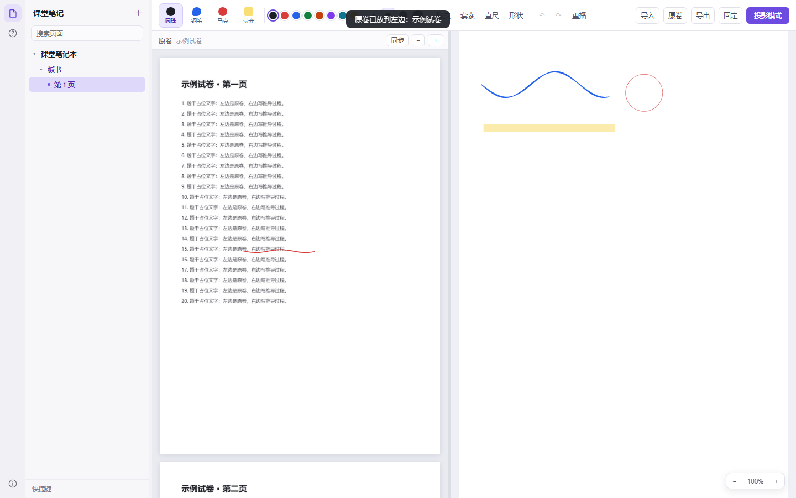

# 课堂手写笔记 · Ink Classroom

一个跑在浏览器里的手写白板：**左边放原卷、右边无限向下写草稿，两边都能写**。
界面结构参考 Codex 桌面端（图标条 + 可收起的文件夹树），手写按数位板场景做过压感与平滑调校。



## 功能

**导航**
- 左侧图标条 + 文件夹树（文件夹 → 分区 → 页面）
- 侧栏可拖拽改宽，拖到最窄自动收起；点图标条切换显示
- 页面搜索、双击改名、右键删除

**双栏工作区**
- 左：原卷（PDF / Word / 图片），多页连续排列，可缩放 0.6×–8×，支持 Ctrl+滚轮
- 左栏可以直接批注，笔迹跟随卷面缩放，切页不丢
- 右：无限向下画布，写到快到底自动加长
- 右栏放大后可以**左右滑动**（横向滚动条 / 按住空格拖动 / 中键拖动），缩放 0.5×–3.5×
- 两栏各自滚动，可开「同步」联动；中间分隔条可拖动

**手写**
- 四种笔：圆珠笔 / 钢笔（压感笔锋）/ 马克笔 / 荧光笔，各自记住颜色粗细
- 压感曲线、笔迹平滑、形状识别（直线 / 方框 / 椭圆）
- 直尺工具、Shift 吸附 12°
- 橡皮按笔迹擦除
- 套索：移动、四角缩放、对齐、等距、旋转、复制粘贴、删除
- 墨迹重播、撤销重做（两栏共用一套栈）
- 自制笔尖光标，隐藏系统光标

**界面**
- 工具栏停留 2.6 秒自动收起，光标移到顶部 8px 呼出，按 H 固定
- 投影模式（P）全屏去面板

## 打开

```
# 直接双击 index.html，或起本地服务（推荐，IndexedDB 才能持久化原卷）
python -m http.server 8000
# 打开 http://localhost:8000
```

## 快捷键

`1-4` 切笔 · `E` 橡皮 · `L` 套索 · `R` 直尺 · `H` 固定工具栏 · `P` 投影模式 · `空格+拖动` 平移画布 · `Ctrl+Z/Y` 撤销重做 · `Ctrl+C/V/X` 复制粘贴剪切 · `Delete` 删除选中 · `Esc` 取消选中 / 退出投影

## 目录

```
index.html        主界面骨架
style.css         样式
app.js            画布、墨迹、导航、导入等全部逻辑
import.js         PDF / docx / 图片解析（本地完成，不联网）
vendor/           pdf.js（离线渲染 PDF）
```

## 数据

- 结构 + 笔迹 + 原卷批注：localStorage（`ink-classroom-v3`）
- 原卷图片：IndexedDB（`ink-classroom-assets`）

## 已知限制

- 手写转文字没做（要接 Windows OCR 或在线服务）
- Word 只取正文文字，复杂排版 / 图片会丢
- PDF 里没嵌字体的中文可能缺字
- 原卷区不支持套索选择（只能写和擦）
- 录课暂不做
- 网页壳，跟手程度到不了 OneNote 原生级别

## 下一步

1. 原生化：.NET 8 + WinUI 3 + Win2D，输入走 WM_POINTER + 合并点，目标 <20ms
2. 手写 OCR / 公式识别
3. 局域网学生端：只传笔迹矢量，几 KB/s
4. 录课：笔迹时间轴 + 音频，导出 MP4